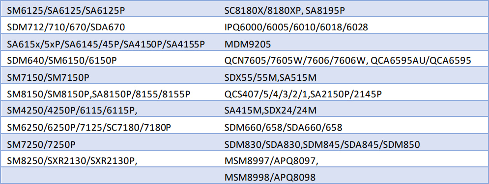

# Katana

A BootROM exploit for Qualcomm devices released within 2016 til 2019.

## Brief Explanation of the Exploit

With the MSM8998 (Nazgul) SoC, the command 0x13 (SAHARA_RESET_STATE_MACHINE_ID) was added. The command
called into `boot_sahara_entry`, which is supposed to reinitialize Sahara. The flaw is that each call into
it decreases the stack pointer by 0x60 and there is no stack guard. With enough calls, we exhaust the available
stack space (0x3000), corrupt memory beyond the stack and make stack buffers overlap with some of the global function
pointer tables. `secboot_verify_cert_signature` will read the modulus and signature in BIGINT format into stack buffers.
Since `crypto_ftbl->ModExp` was overwritten by the buffers, `secmath_BIGINT_modexp` will jump into our shellcode from the modulus.

More can be found at [HEXACON2023 - Bug Tales : Life and Death in the Sahara](https://www.youtube.com/watch?v=3Zs45Cl3HfQ)

## Known vulnerable SoCs

>[!CAUTION]
> Even if the SoC is vulnerable, it does not mean that you can exploit it!
> If your SoC is listed here, do NOT store any secrets on a device with it.
> Cellebrite, MSAB and Oxygen Forensics are able to decrypt the user data on
> Devices with such SoCs, thanks to this CVE.



## Usage

```
usage: katana.py [-h] -s SOC -e EXPLOIT [-f FIREHOSE]

A PoC for the CVE-2021-30327 vulnerability in Qualcomm Sahara

options:
  -h, --help            show this help message and exit
  -s, --soc SOC         SoC model
  -e, --exploit EXPLOIT
                        Exploit PBL (CVE-2021-30327) with a payload
  -f, --firehose FIREHOSE
                        DevPrg image in case the payload reinitializes Sahara
```

## Credits
- [CVE-2021-30327](https://nvd.nist.gov/vuln/detail/cve-2021-30327) ```This is the CVE which Katana exploits```
- Iskuri (Christopher Wade) ```Reported CVE-2021-30327 to Qualcomm```
- Seamus Burke & Aaron Willey - First people who exploited this CVE, showcased it at [HEXACON2023](https://www.youtube.com/watch?v=3Zs45Cl3HfQ)
- [R0rt1z2](https://github.com/R0rt1z2) ```Helped with sniffing this exploit```
- [kethily-daniel](https://github.com/kethily-daniel) ```Gave me a tool which was exploiting this exact Vulnerability```
- [halal-beef](https://github.com/halal-beef) ```Script base```
